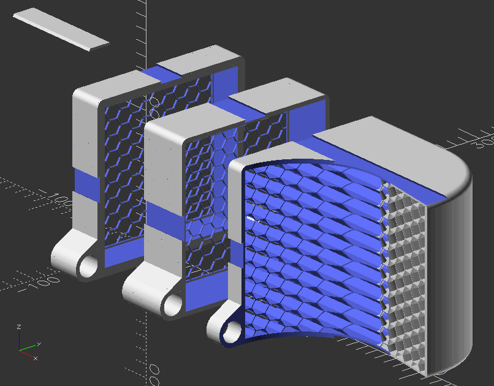

# Filter Stack Generator

Generates a horizontal holder for a series of air filters and a fan, built in OpenSCAD from inexpensive commodity parts.

## My Solution

The builder provides a set of optional features, each with minor customizations suited to its function.

In airflow order:

* Magnetic Intake 
  * Provides a small inset for a magnetic strip to hold a nylon mesh filter, such as https://amazon.com/dp/B0BMXLRJBF using a magnet strip like https://amazon.com/dp/B019EQB086 (those might not be the best combination, just what I had on hand).
  * Available parameters should permit adjusting to many other combinations
* Bulk Tacky Media
  * Provides an open volume for inserting "tacky" polyester media such as https://amazon.com/s?k=tacky+MERV8+Polyester+Media (this is a search, the specific one I bought isn't listed anymore). I have one of the Orange/White MERV8. At their current prices, I wouldn't recommend buying them just for this project.
  * I'm not sure I would have included this, but after cutting out pieces for my main A/C, I ended up with leftover strips that I never knew what to do with, so I'm trying them here.
* Main Filter
  * A space for a general purpose, off the shelf, filter 
  * This is the key filter I was designing for, a simple "off the shelf filter" 
* Blower
* Laminar Exit
* End Cap
* Rods

## Why I Made This

I've grown weary of the small air filters for use around my desk. The existing products all seem to fall short of what I want. 

A problem I've encountered when it comes time to replace the filters is dealing with manufacturers and their prices. So, this uses simple 120mm fans and benefits from the many PC oriented products available online.

## Setup and Usage

Download the `fan-filter-stack.scad` and get the latest [OpenSCAD developer snapshot](https://openscad.org/downloads.html#snapshots). At the time of this writing, the release versions are significantly out of date and suffer from severe performance issues.

Once you have installed OpenSCAD, open the SCAD file, then make the following settings changes (these may change over time, so be prepared to hunt around):

- Edit > Preferences > Features> [x] manifold
- Design > [x] Automatic Reload and Preview 
- Window > [ ] Hide Customizer (so it is visible in the right sidebar)
- In Customizer: 
  - [x] Automatic Preview
  - (dropdown) Description Only (optional, but helpful)

## OpenSCAD In Customizer

The main render window updates as you make changes in the Customizer view, showing what the controls are doing. 

Generally, there are no enforced limits; it's easy to create combinations that aren't printable.

To restore the settings to a sane value, select the "Design Default" option from the dropdown under Automatic Preview. If you create a set of options you want to return to, you can name them with the "+" to the right.

---

#### Updates:

##### 2025-Sep-07

- Initial release.
